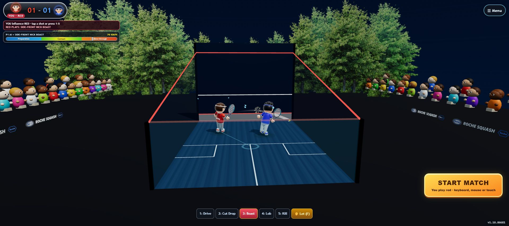
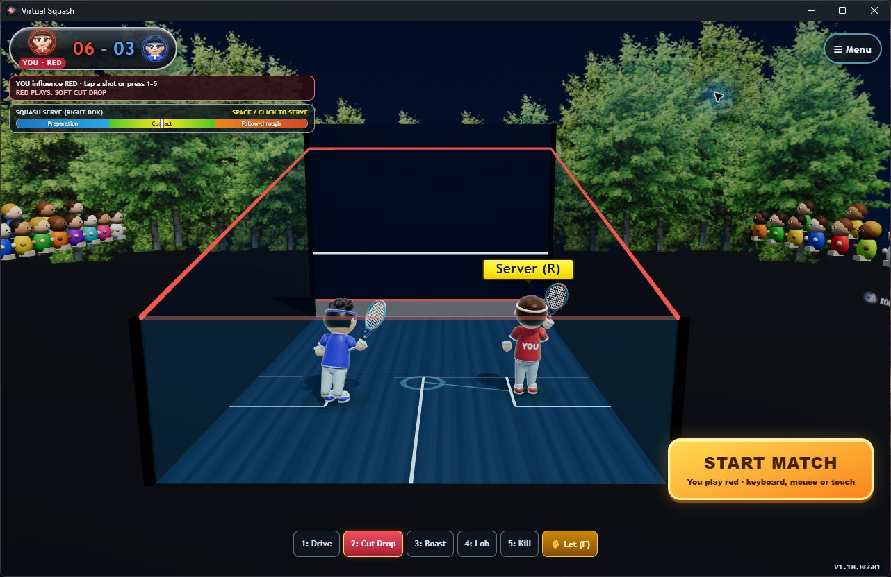

# Platform startup and billing inspection — 30 October 2026

Scope: inspect and launch the existing product, describe its startup and payment state, and record the operator's requested Google Play purchase options. This is an observation report, not a billing implementation or product-change acceptance record. No runtime source, store catalog, prices, credentials, or environment files were changed.

## Actual launches

- Web: opened https://squash.robin.mba/ in Chrome. The first accessibility snapshot and screenshot showed cached v1.17.84079. A subsequent snapshot and saved screenshot showed v1.18.86681. HTTPS deployment.json independently returned version 1.18.86681 and source commit 6a2a5a498f98ade0e409eaac869a2541fc49a3a4. This observes the returning browser's version transition, not a controlled fresh-install/offline test.
- Windows: launched dist/squash-arcade-v1.18.86681-windows-x64.exe directly. The native window was titled Virtual Squash; its WebView2 document used http://tauri.localhost/ and displayed v1.18.86681. The release metadata declares the executable unsigned. No installer or Store installation was performed.
- Both ran the animated court with AI-controlled red and blue players, live scoring and replays, a prominent START MATCH button, shot controls, red-player identity and Menu. No purchase or account screen appeared.
- Both subsequently displayed the automatic instructional briefing. The Windows phone chapter visibly said pairing required a relay-enabled court and disabled Pair phone. Closing each briefing returned to the court; screenshots below were saved after that close action. No START MATCH action or payment was performed in this inspection.
- An initial Windows screenshot captured an overlapping browser window despite returning the correct application accessibility tree. That image was rejected as evidence. The saved Windows image was captured after raising the actual Virtual Squash window and visibly includes its title bar and game.

## Shared initialization

index.html supplies the canvas and HUD. On DOMContentLoaded, src/game_engine.js constructs ArgonSquashEngine, creates the Three.js WebGL renderer, scene, camera, court, rules, AI, input, HUD, audio and motion systems, then calls loadAssetsAndStart(). Six GLB assets load concurrently from packaged/same-origin assets: stadium, player, opponent, racket, ball and crowd. The engine prepares actors and scenery, selects its URL-dependent initial state, starts the clock and enters requestAnimationFrame update/render.

No dedicated application initialization splash, progress UI or readiness gate is implemented. No timed recording of the first blank/native/browser frame was made, so a particular flash color or load duration is not established. The post-load instructional briefing is not a loading splash. Asset loading retries four times after the first attempt, then returns an empty Three.js group on failure; this can continue initialization with missing content and is a current production gap.

The ordinary root URL enters an indefinite AI-versus-AI showcase with the setup menu collapsed. The user can press START MATCH to take control of red; the normal start path defaults to red serving, with racquet spin an opt-in setting. Audio has a gesture-unlock path; hearing speech/music was not verified in this inspection. Camera access is requested through the camera action, not required for ordinary keyboard/touch entry.

ArcadeBriefing accumulates eligible visible idle time and opens after 18 simulation seconds on first presentation, then after 95 seconds on subsequent presentations. Its three chapters explain tactics/red identity, phone racket and camera play. Advancement also depends on speech completion. Thus the initial screen does not remain visually stationary while awaiting input.

## Platform differences and current payments

| Platform | Load and initialization | Current payment behavior | Observation scope |
|---|---|---|---|
| Browser web | HTTPS HTML/JS/CSS/assets, shared WebGL initialization; deployed PWA-enabled output can register its worker | No checkout, entitlement check or restoration flow | Actually launched in Chrome |
| Installed PWA | Browser-managed installation/launch appearance and cache; manifest start_url is ./?play=1, different from root URL | No checkout or entitlement service | Source inspection only; no installed-PWA launch this turn |
| Windows standalone / installer packages | Tauri starts a WebView2 window and loads bundled frontend/assets; service-worker registration is excluded for native origins | No payment adapter, Microsoft Store purchase integration or shared ownership check | Standalone EXE actually launched; MSI/MSIX/NSIS install flows not exercised |
| Android | Tauri Android host loads bundled frontend in Android WebView, then the same game initialization | No Play Billing dependency/adapter, catalog query, native purchase sheet, token verification or restoration implemented | Source/artifact metadata only; no Android launch/purchase this turn |
| Linux AppImage / DEB / RPM | Tauri Linux webview with bundled frontend, then shared initialization | No payment adapter or shared ownership check | Packaging/source only; not launched |
| iOS/macOS | No delivered targets established by the current release matrix | No implemented store adapter established | Not delivered or exercised by this inspection |

PWA detail: the ?play=1 path sets autoPlayMode and reaches a different showcase branch that seeds score 4–3. Ordinary root entry resets the match score. These should not be described as identical startup states. The PWA manifest provides icon/background/theme launch metadata; browser/OS rendering varies. Android system launch appearance was not observed. Neither constitutes an app-managed splash tied to completion of assets and ownership restoration.

Android release metadata: package identity mba.robin.squash, arm64-v8a, versionCode 101886681, canonical version 1.18.86681, unsigned artifacts. APK/AAB existence does not establish a Play track upload or working billing. package.json and Cargo.toml contain no payment SDK; src-tauri/src/lib.rs adds only debug logging to the Tauri builder. The only environment template currently contains AI tuning variables; no .env or .env.local exists in this checkout.

## Requested Android purchase contract

Use Google Play in-app billing for monthly, six-month and annual auto-renewing base plans, and a separate non-consumable one-time lifetime unlock. Monthly, every six months and yearly are supported Play billing periods. Lifetime access is not an infinitely recurring subscription. A permanent unlock must not be consumed.

Desired startup: platform launch screen -> branded initialization display while assets and existing ownership are resolved -> ready court with a clear START MATCH action and the correct access state. Existing purchasers must restore access before being offered another purchase. Store loading must not leave an indefinite splash. The precise free-versus-paid gameplay boundary is not specified by this rundown and is not implemented here.

Desired purchase: query current Play product details and eligible offers -> show actual localized price/period -> user selects plan -> native Play purchase sheet -> process purchased/pending/canceled state -> verify purchase token -> persist game-account ownership -> grant access and acknowledge delivery -> show success and enter the game. Pending is not paid; cancellation is not success. Restore on launch/resume, reconcile renewals, expiration, refunds and revocations. Cancellation of auto-renewal retains access until the paid period expires.

The earlier chat's intended cross-platform model was Play purchase -> verified game-account entitlement -> access on other clients. That account/entitlement service does not exist in this checkout. Google Play is the Android checkout; it is not a generic desktop/browser gift-card checkout. Windows/web/Linux could restore an account-linked Play entitlement once that real shared service exists. No non-Android checkout provider was selected or implemented here.

## Prices and provenance

Read the existing chat titled Assess Android Pricing and Refunds (01a18931-2c73-701b-9c6b-70800051f0f1). It explicitly lacked a verified comparable-game pricing/refund dataset, suggested USD 0.99 / 1.99 / 2.99 / 4.99 as upfront-price scenarios, and later recommended a free download with one permanent full-game purchase. It did not establish subscription-period defaults.

For the newly requested four-option offering, a proposed low-entry launch ladder is USD 0.99/month, 3.99 per six months, 5.99/year and 9.99 lifetime. These are new commercial judgment calls, not recovered research findings, active Play prices or measured market benchmarks. Subscription value and lifetime coverage need to match the actual benefits delivered.

The intended configuration can use annotated operator catalog settings such as SQUASH_PRICE_CURRENCY, SQUASH_PRICE_MONTHLY, SQUASH_PRICE_SIX_MONTHS, SQUASH_PRICE_ANNUAL and SQUASH_PRICE_LIFETIME. These names are a proposed schema only and have not been added as unconsumed runtime settings. Configured prices must be applied to the real Play catalog via Console or the publisher API; changing a local .env alone cannot change Google's charged price. The customer UI must use returned Play ProductDetails prices, not invented/fallback checkout prices. Actual product/base-plan IDs are required; none were fabricated.

## Sources and limits

- src/game_engine.js: constructor, loadAssetsAndStart, _bootInitialStateFromURL, DOMContentLoaded listener.
- src/squash/CourtHUD.js: entry button, match start and persisted spin option.
- src/squash/ArcadeBriefing.js: idle presentation thresholds and chapters.
- src/pwa.js; public/manifest.webmanifest; src-tauri/tauri.conf.json; src-tauri/src/lib.rs; package.json; src-tauri/Cargo.toml; .env.example.
- https://developer.android.com/google/play/billing/integrate
- https://support.google.com/googleplay/android-developer/answer/140504?hl=en
- https://developer.android.com/google/play/billing/subscriptions

KStore canonical production, independent-delivery and annotated-environment rules were read at their current heads (revisions 2, 1 and 2 respectively). This report and real screenshots are inspection evidence only. No continuous startup screencast, payment, Android device run, Linux run or product implementation acceptance is claimed. No automated tests or rebuild was run for this documentation-only inspection.
