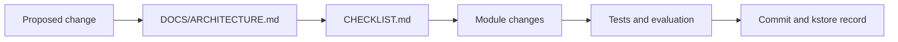

# Squash Arcade

**Physical chess, wonder first.** A 3D arcade squash game for the browser, featuring rally physics, expressive stylized players, keyboard/mouse controls, optional live camera motion control, opponent AI, shot variation, and a tunable simulation.

> **Project state:** Active prototype, not a certified squash simulator or finished cross-platform multiplayer release. The most straightforward release today is a browser-hosted **single-player** game. Features described below as *experimental* or *backend-dependent* must not be treated as validated on every phone, TV, or browser.

## At a glance

| Capability | Source status | Notes |
| --- | --- | --- |
| 3D court, ball and racket | Present | Three.js rendering and modular squash physics |
| Single-player versus computer | Present | Browser-executed game and opponent logic |
| Keyboard/mouse stroke input | Present | Most reliable starting configuration |
| Device webcam / Pose Cam input | Present, device-dependent | Camera permission and WebGL/MediaPipe support required |
| Forehand/backhand biomechanical interpretation | Present | Heuristics/classifier require physical stroke validation |
| Two-zone Kinect-style camera mode | Experimental | Two movement zones are **not** equivalent to reliable two-skeleton person tracking |
| Handheld phone as racket | Companion page present; backend-dependent | `public/companion.html` collects motion/orientation and posts events to `/api/racket/*` |
| Two phone controllers / 1v1 rooms | Development/preview backend scaffolding | Room/telemetry handlers currently reside in `vite.config.ts`, not production `dist/` |
| TV casting / Chromecast receiver | Not established | Screen mirroring or external display may work; dedicated Cast integration isn't provided |
| Tauri 2 Android, Windows, Linux packaging | Not present | Requires a new `src-tauri/` project and platform validation |
| Hosted/paid LLM inference | **None — no inference path exists** | Unused `@google/genai` dependency and `GEMINI_API_KEY` define removed (TASK-18); see the audit below |

## What it is

The design seeks an approachable, entertaining squash game without teaching fundamentally wrong court mechanics. Ball trajectories, positioning, swing preparation and retrievals should be credible even where animations and effects are deliberately exaggerated.

Game modules include court geometry, ball physics, nick collisions, shot selection, player movement, opponent AI, rules, biomechanical stroke classification, shot tuning, and deterministic test tools. The product separates a playful arcade presentation from reusable engineering foundations intended to converge with other racket-sports and motion-analysis projects.

### Key files

| Path | Responsibility |
| --- | --- |
| `index.html`, `styles.css` | Game page, setup, HUD and styling |
| `src/game_engine.js` | Three.js orchestration, actors, rally lifecycle and room integration |
| `src/motion_controls.js` | Keyboard/mouse, camera/pose, and phone-input glue |
| `src/squash/BallPhysics.js` | Ball collision and trajectory dynamics |
| `src/squash/ShotController.js` | Stroke production |
| `src/squash/BiomechStrokeClassifier.js` | Forehand/backhand and motion interpretation |
| `src/squash/OpponentAI.js` | Computer-controlled opponent |
| `src/squash/PlayerMovement.js` | Court movement and recovery |
| `src/squash/TuningConfig.js`, `TuningPanel.js` | Runtime tuning and inspection |
| `src/squash/TestHarness.js` | Deterministic regression/test infrastructure |
| `src/audio_engine.js` | Audio, music and effects |
| `public/companion.html` | Experimental phone-controller web page |
| `vite.config.ts` | Vite build/dev configuration **and** dev/preview API middleware |
| `scripts/download-assets.mjs` | Build-time asset downloader |
| `DOCS/ARCHITECTURE.md` | Architecture snapshot/digital twin |
| `CHECKLIST.md` | Sequential implementation and verification recipe |

## Run locally

Requirements: Node.js/npm or Bun; modern browser with WebGL. A webcam is optional.

```bash
git clone https://github.com/rebots-online/squash-arcade.git
cd squash-arcade
bun install --frozen-lockfile
bun run dev
```

Open **http://localhost:3000**. npm alternative:

```bash
npm install
npm run dev
```

The package currently uses scripts named `dev`, `build`, `lint`, and `preview`. `lint` runs `tsc --noEmit` (a TypeScript check, not a separate ESLint audit).

### Controls and modes

- **Keyboard/mouse (recommended initially):** The in-game Controls Guide identifies the current shot-selection hotkeys and hold/release controls. Existing guidance describes keys 1–5 for shot categories, Space/left click for stroke preparation/execution, and WASD/arrows for manual positioning. Verify actual bindings in the current build before documenting them as immutable.
- **Pose Cam:** Enable the camera control in the in-game interface, accept permissions, and choose front or rear camera as supported. MediaPipe Hands/Pose and optical-flow fallback are implementation paths; quality varies with occlusion, lighting, frame rate and camera orientation.
- **Auto-T return:** The in-game toggle distinguishes automatic recovery from manual footwork. Follow on-screen instructions for the currently selected mode.
- **Phone racket (experimental):** Open `/companion.html?room=default&role=p1` on a suitable phone *while running the Vite development/preview server*. Allow motion permissions. The companion posts telemetry and strokes to backend routes, which **are absent from the static production build**. Phone haptics require browser/device support.
- **Second player and Kinect split mode (experimental):** Code paths exist for Player 2 and split-zone motion. They need real device validation; do not promise production-ready two-player pose recognition.

**Important:** When using a phone as a physical racket, secure your grip and use appropriate space. The controller produces simulated ball contact and optional vibration, not physical resistance.

## Build a production web site (single player)

```bash
bun install --frozen-lockfile
bun run lint
bun run build
bun run preview
```

Then visit **http://localhost:3000** and smoke-test the compiled game. npm is also usable:

```bash
npm install
npm run build
npm run preview
```

The existing build runs `node scripts/download-assets.mjs && vite build`. On a clean build, this script downloads GLB models and MediaPipe assets from `www.gstatic.com` into `public/assets/`; internet access is necessary. Verify the model files and WASM/model paths in the generated `dist/`. Some media and model URLs remain external. A successful build is not, by itself, proof that all those URLs load in production.

**Publish only `dist/` for current single-player static hosting.** The physics/rendering/camera code executes in the visitor's browser, so you do not need a GPU server or a hosted LLM to serve the playable frontend.

### A. Surge.sh

```bash
bun run build
npx surge ./dist squash-arcade.surge.sh
```

Authenticate with Surge when prompted; replace the domain if unavailable or if using your own domain. Re-run to update. If history-based SPA routes are added, copy `dist/index.html` to `dist/200.html` before publication.

Surge hosts **solo play only**: `/api/racket/*` and `/api/match/*` middleware live in `vite.config.ts` and are absent from `dist/`, so companion-phone and room features do nothing on a static host (see "Why static hosting does not enable phone multiplayer").

### B. Netlify

Connect this repository in Netlify, with:

- Build command: `npm run build`
- Publish directory: `dist`
- Install environment: supported recent Node version; internet access for model downloads.

Or upload `dist/` manually. An optional Netlify SPA fallback may be needed if future client-side routes are introduced; the current root-page game does not require it.

### C. Vercel

Import the GitHub repository as a Vite project. Configure **build** `npm run build` and **output directory** `dist`. Or use `npx vercel --prod` after setting up the project. If adding a wildcard rewrite later, preserve actual asset and API paths.

### D. Nginx / Nginx UI

Nginx UI manages the web server; it doesn't run the frontend application itself. Copy built files into a configured web root:

```bash
sudo mkdir -p /var/www/squash-arcade
sudo rsync -a --delete dist/ /var/www/squash-arcade/
```

Example site definition (configure HTTPS through Nginx UI, Certbot or your preferred certificate provider):

```nginx
server {
    listen 80;
    server_name squash.example.com;
    root /var/www/squash-arcade;
    index index.html;
    location / {
        try_files $uri $uri/ /index.html;
    }
}
```

### E. Hostinger

On an ordinary static/web-hosting plan, build locally and upload the **contents** of `dist/` to the domain's `public_html/`. HTTPS is necessary for normal public camera use. A VPS or suitable persistent service will be needed if online room APIs are later enabled.

### F. Oracle Cloud Free / other Linux VPS

An ordinary VM with Nginx is enough for **browser-rendered solo play**; the server does not perform the game physics or computer vision. Build on a workstation or CI runner, transfer `dist/` to `/var/www/squash-arcade/`, configure the Nginx site above, point DNS to the VM, allow ports 80/443 through the OS and cloud firewall, and enable TLS. OCI Always Free eligibility, resource allowances, and regional capacity vary and must be checked before deployment.

## Why static hosting does not enable phone multiplayer

The repository's `vite.config.ts` contains room and telemetry HTTP handlers (including routes under `/api/racket/*` and `/api/match/*`). The Vite middleware runs in **development and preview**, but it is **not part of the generated `dist/`**.

Consequently, a plain Surge/Netlify/Vercel/Nginx upload can run the single-player browser game, yet a separate companion phone calling `/api/racket/swing` on that static domain receives no working API response.

To release multiplayer:

1. Record the proposed deployment architecture in `DOCS/ARCHITECTURE.md`.
2. Convert it to testable tasks and acceptance gates in `CHECKLIST.md`.
3. Extract session/telemetry APIs into an independently deployable server (or suitable managed real-time infrastructure).
4. Configure the frontend/companion API base URL securely, implement room authorization, and verify consistent authority over score/ball state.
5. Validate local two-phone play, latency, haptics, disconnect/rejoin and camera two-person edge cases.
6. Only then advertise two-controller and remote rooms as generally available.

A TV-connected PC running the game is the easiest proof-of-concept shared display. Browser screen mirroring is device-dependent; Chromecast sender/custom receiver support is not established by current source files.

## Hosted AI / paid services audit

**Source-reviewed finding (2026-10-16):** The game depends on local browser-executed deterministic physics and opponent/game code. The reviewed `src/game_engine.js`, `src/motion_controls.js`, `src/audio_engine.js`, and companion page do **not** show an active call to a hosted LLM inference endpoint during gameplay.

**Nonetheless, review these dependencies before publishing commercially:**

- ~~`package.json` declares `@google/genai`; `vite.config.ts` defines `process.env.GEMINI_API_KEY`~~ — **removed in TASK-18** (the dependency was never imported and the key was never read). No secret key exists in the public bundle. Any future inference must be placed behind a secure backend.
- The jukebox labels several tracks as **Lyria 3**, but `src/audio_engine.js` points at prerecorded `.mp3` files on `www.gstatic.com`. Playing those hosted files is **not live Lyria generation/inference**. Confirm the licensing and redistribution rights of third-party material before a commercial launch.
- MediaPipe Hands/Pose uses browser-side inference, with some scripts/models loaded from public CDN/Google-hosted assets. This involves network downloads and third-party availability, not necessarily a pay-per-inference API.
- The build downloader fetches models from `www.gstatic.com`. Some GLB asset identifiers retain tennis-starter names; provenance, licensing, and squash-specific visuals require review.
- Network/CDN/hosting and bandwidth charges remain possible, even where **no paid LLM calls** occur.

This is a source audit, **not** a billing-account inspection, exhaustive security audit, license clearance, or a guarantee of zero third-party costs.

## Native applications — planned, not currently built

The browser frontend is a candidate for **Tauri 2** packaging into Android APK/AAB, Windows MSI/NSIS, and Linux desktop bundles. This repository does not currently include `src-tauri/` or verified native packaging. A future implementation must handle camera/sensor permissions, WebView/GPU support, mobile safe areas, offline asset bundling and the multiplayer backend boundary. Do not describe the existing app as a native Android app solely because it can run in a mobile browser.

## Testing and known limitations

Before publishing a release, record the tested commit, target host, browser/device, frame rate, camera permission result, and unresolved issues.

- Check root page, model assets, CDN dependencies, audio and WebGL.
- Check keyboard/mouse shot choice, movement, AI rallies, scoring and resets.
- Check webcam front/rear selection, camera permissions, actual stroke recognition and graceful no-camera fallback.
- Test the physically important ball collision order: ordinary good length drives generally bounce on the floor before the back wall; hard overhit drives can reach the back wall on the fly. Compare observed distributions rather than imposing scripted results.
- Ensure characters approach a **viable hitting stance** rather than placing their body at the ball coordinate; allow genuine misses and unreachable balls.
- Treat the split-zone Kinect controller, online play and phone racquets as experimental until end-to-end tests pass.
- Confirm 404/CORS/CSP/mixed-content errors are absent on an HTTPS production deployment.

## Architecture-first contribution policy

Project development follows the canonical order:



Architecture is the digital twin of the intended system; the checklist is the executable recipe. Include explicit metadata headers, module ownership, requirement/task identifiers, kstore references, confidence/rollback handling, validation, and commit provenance. Divide work into independent tasks suitable for a GLM-5.3 (or highest appropriate) non-reasoning executor. Shared capabilities should remain separable so other projects can consume them without a tightly coupled monolith.

## Project status and provenance

- **Repository:** [rebots-online/squash-arcade](https://github.com/rebots-online/squash-arcade)
- **Architecture:** [DOCS/ARCHITECTURE.md](DOCS/ARCHITECTURE.md)
- **Execution plan:** [CHECKLIST.md](CHECKLIST.md)
- **Prior sibling repository:** [rebots-online/vSquash](https://github.com/rebots-online/vSquash)
- **Documentation reviewed:** 2026-10-16
- **Verification:** Repository inspection only; no deployment or device test is claimed.

Commercial release needs an explicit review of third-party licenses, audio/model provenance, privacy disclosures for camera/sensor permissions, accessibility, and applicable platform distribution requirements.
